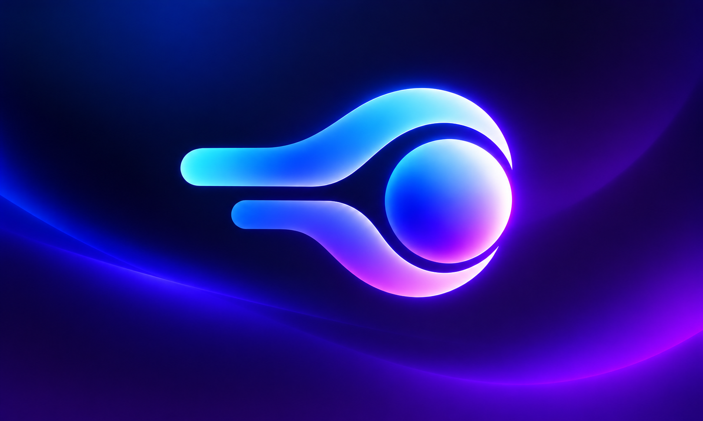
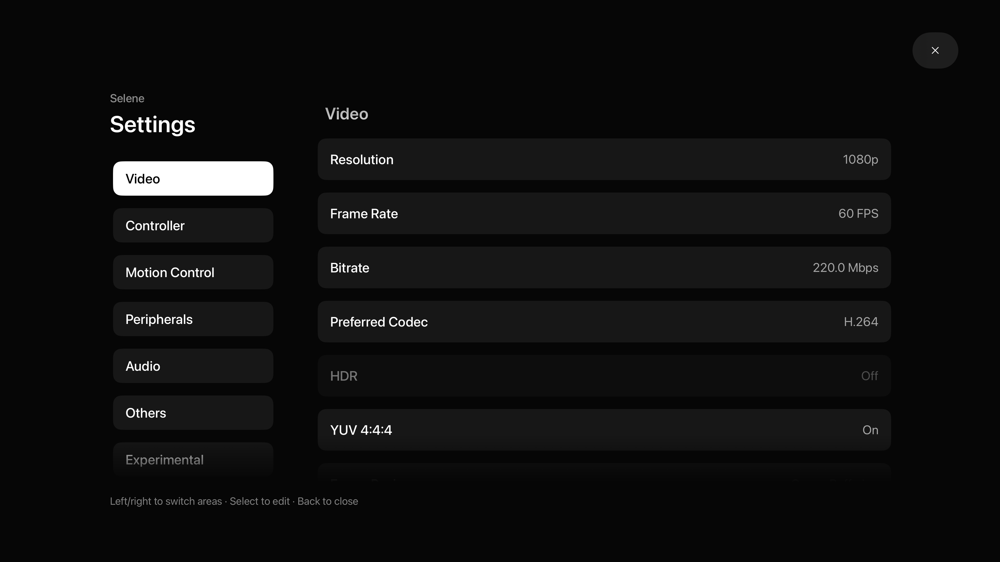

# Selene

[English](README.md) | [简体中文](README_CN.md)

<p align="center"></p>

An open-source game streaming client for **Apple TV**, built on the Moonlight ecosystem. Stream your PC games and desktop through Sunshine, with a tvOS interface designed for the Siri Remote and native controller navigation.

**In development.** There is no public binary or TestFlight release yet. Build and sign the app using Xcode. See the [verification record](docs/SELENE_VERIFICATION.md) for actual test results.



## Features

- **Made for Apple TV:** Siri Remote focus navigation, a single PC-to-app entry, restored focus, modern settings, compact covers, and English / Simplified Chinese / Traditional Chinese.
- **Streaming quality:** 360p through 4K, 2K / 3K and custom resolutions; H.264 / HEVC, capability-gated hardware AV1, HDR10 when supported, and Stereo / 5.1 / 7.1 audio.
- **High bitrate:** exact entry from 0.5–800 Mbps, live host requests with rejection feedback, separate received-bandwidth statistics, and optional bounded adaptive bitrate. **800 Mbps is a configuration limit, not guaranteed throughput.**
- **Stream menu:** Back opens the menu and Back again resumes; statistics, keyboard shortcuts, explicit text entry, configurable shortcuts, and separate disconnect / confirmed close-app actions.
- **Picture and performance:** aspect fit or stretch, nine-point alignment and offsets, statistics placement, quality reminders, and native interpolation on supported hardware with latency fallback and observed-frame diagnostics.
- **Controller tools:** local input testing, independent stick deadzones, center calibration, and session mouse mode with pointer / scrolling speed controls. Optional Win+L on ordinary disconnect starts disabled.
- **Host controls:** confirmed Windows scaling using host-advertised presets and host-provided commands. Foundation-specific monitor arrangement and input-only sessions are opt-in; saved stream settings can be applied by reconnecting without closing the PC app.
- **Privacy and help:** device / requested / negotiated capability reports, operation guides, local diagnostic QR codes, validated settings backup / restore, and optional foreground reconnect.
- **Experimental microphone forwarding:** tvOS 17+ Continuity microphone selection from an iPhone or iPad, explicit permission, host negotiation, muted start, and 48 kHz mono Opus forwarding.

## Limits and validation

Dolby Vision, Dolby Atmos and height-channel layouts are not supported by this stream path. AV1 has no software fallback. Live resolution / HDR switching, host render scaling and capture-monitor selection are not exposed; use **Host controls → Apply settings and reconnect** for saved stream settings.

Host extensions depend on the installed Foundation Sunshine version. Monitor arrangement is a request, not proof of the resulting Windows topology; accepted commands do not confirm completion. Microphone forwarding requires a connected Continuity device and a host microphone extension, and does not capture the Siri Remote microphone. Native interpolation requires supported Apple hardware and tvOS 26+.

Client code and automated checks are separate from physical acceptance. The new host controls, microphone/audio routes, sustained HDR, high-bitrate performance and controller behavior still need Apple TV validation. See the [verification record](docs/SELENE_VERIFICATION.md) and [platform feasibility review](docs/ANDROID_MENU_ROADMAP.md). No public binary or TestFlight release is currently available.

## Build and install

Requirements: macOS, **Xcode 26 or later**, and **tvOS 16 or later**. Current development uses Xcode 27.

```sh
git clone --recurse-submodules https://github.com/jacobswin/Selene.git
cd Selene
open Selene.xcodeproj
```

1. Select the **Selene** scheme and the main Selene tvOS target.
2. In **Signing & Capabilities**, enable automatic signing and select your own development team. Choose your own unique bundle identifier if required.
3. Pair the Apple TV in Xcode's **Devices and Simulators**, select it as the run destination, and run. A 4K simulator supports UI checks, but cannot establish physical decoder or HDR capability.

Unsigned compile check:

```sh
bash BuildScripts/build-tvos.sh Debug
```

See [building and pairing](docs/BUILDING.md). When upgrading an existing development installation, keep its bundle identifier to retain pairing and settings.

## Connect and play

Run Sunshine on the PC. Development currently uses [Foundation Sunshine](https://github.com/AlkaidLab/foundation-sunshine); compatibility with every Sunshine version has not been established.

Select a discovered computer or use **+** to enter its address. Select the computer to pair, then enter the PIN shown by Selene in Sunshine's pairing page. Selecting a paired computer opens its applications; **Desktop** remains an ordinary app in that list.

Use the Siri Remote to navigate and select. During streaming, Back/Menu opens the stream dialog; disconnecting keeps the PC app running, while Disconnect and close app also requests that the host close it. A connected controller uses native tvOS focus in the interface and supplies game input during streaming. Open settings through the gear button.

## Origins and acknowledgements

The direct Apple-client code base is [VoidLink](https://github.com/The-Fried-Fish/VoidLink-previously-moonlight-zwm), itself derived from [Moonlight iOS/tvOS](https://github.com/moonlight-stream/moonlight-ios). Original copyright notices and the [upstream README](docs/UPSTREAM_README.md) are retained.

Other references include [Moonlight Android](https://github.com/moonlight-stream/moonlight-android), [Moonlight Qt](https://github.com/moonlight-stream/moonlight-qt), [Moonlight Embedded](https://github.com/moonlight-stream/moonlight-embedded), historical [Moonlight Chrome](https://github.com/moonlight-stream/moonlight-chrome), [Moonlight Common C](https://github.com/moonlight-stream/moonlight-common-c), and [Moonlight V+](https://github.com/qiin2333/moonlight-vplus). The pinned protocol submodule uses the upstream [VoidLink C fork](https://github.com/TrueZhuangJia/voidlink-c).

Selene is an independent community project. References do not imply official affiliation or endorsement.

## License and contributions

Distributed under [GPLv3](LICENSE.txt). Dependencies retain their own licenses. Contributions and reproducible bug reports are welcome; include device model, tvOS and host versions, stream settings, and reproduction steps. Remove private addresses and pairing codes from shared evidence.
